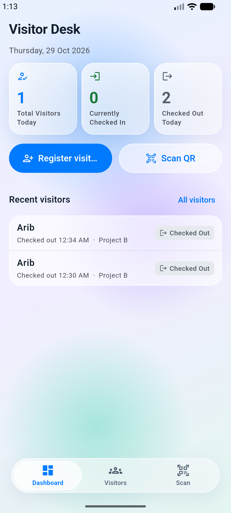
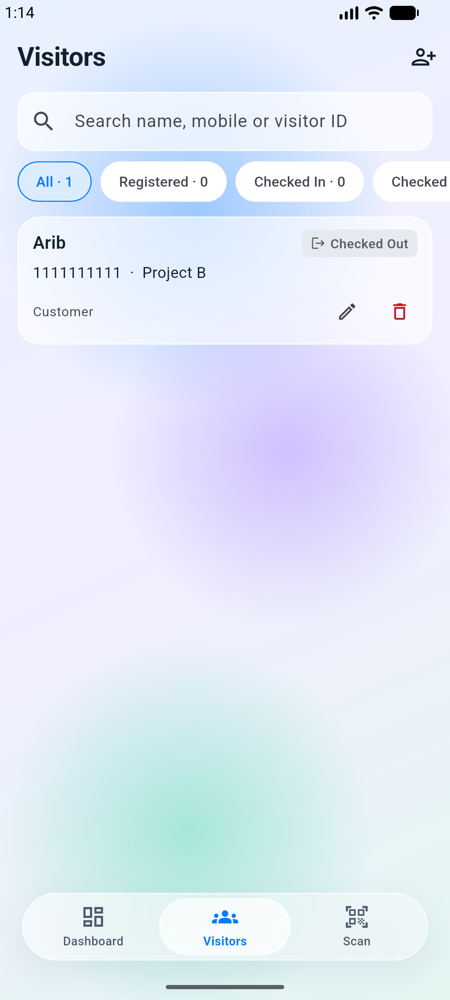
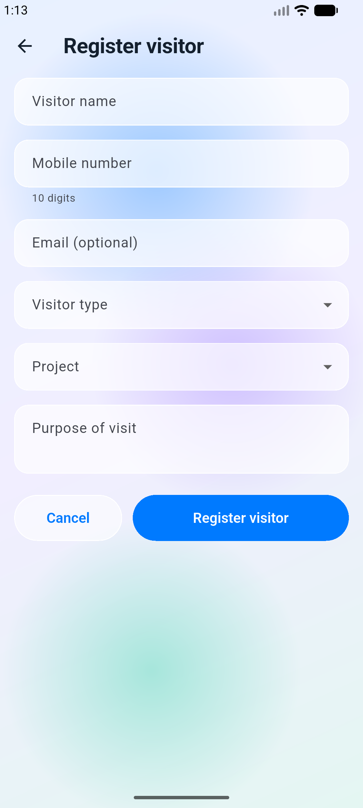
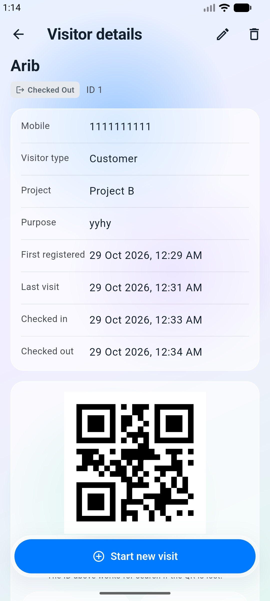
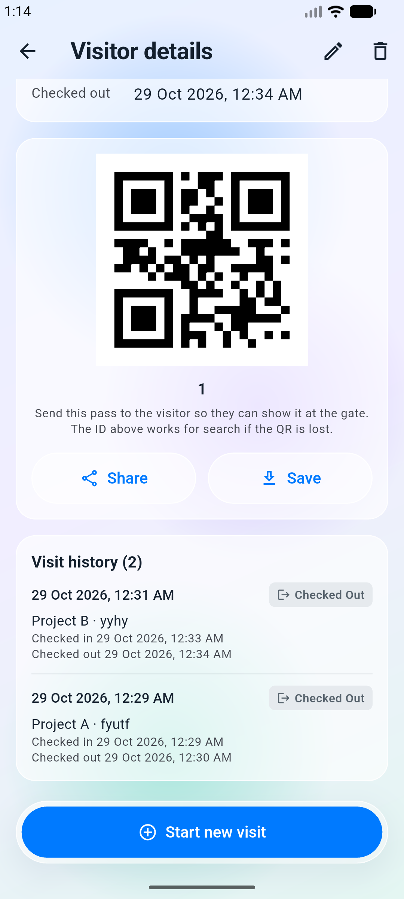
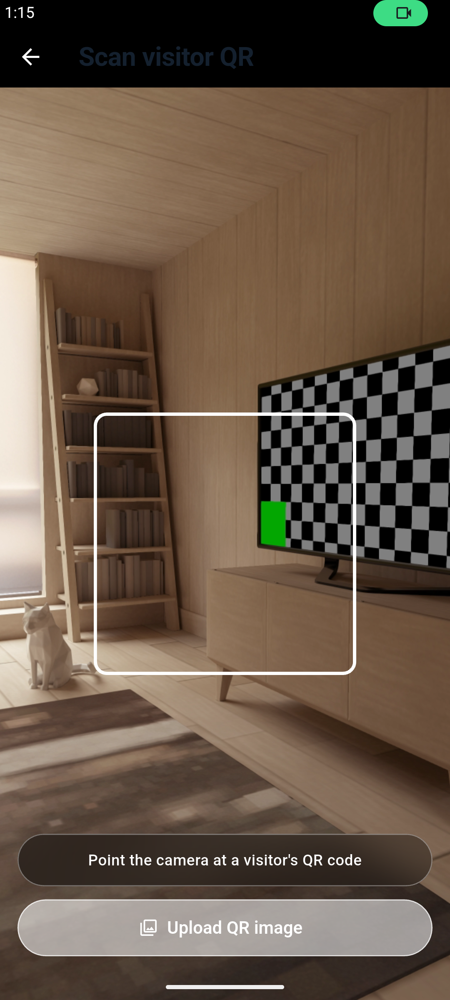
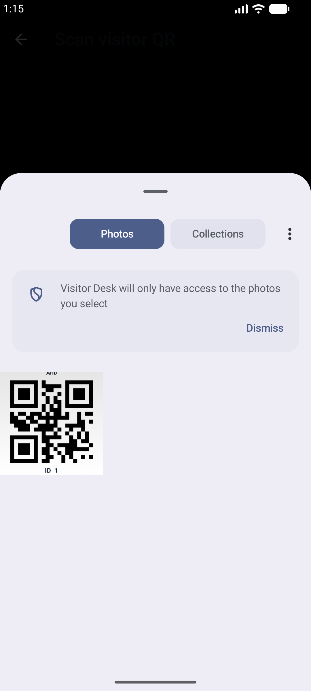
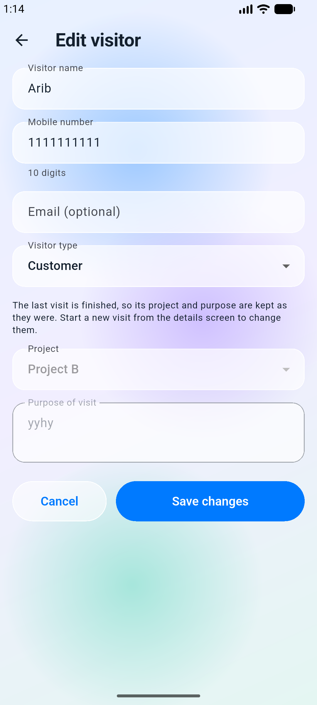
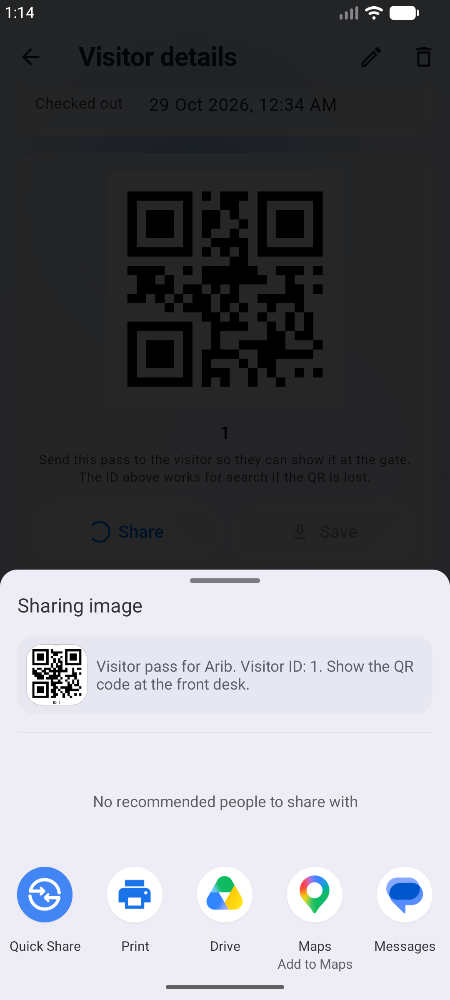

# Visitor Desk - Visitor Management App

A Flutter Android application for front-desk and security staff. It supports visitor registration, visitor records, QR passes, and check-in/check-out.

## Screenshots

<table>
  <tr>
    <td align="center"><b>Dashboard</b></td>
    <td align="center"><b>Visitor List</b></td>
    <td align="center"><b>Registration</b></td>
  </tr>
  <tr>
    <td></td>
    <td></td>
    <td></td>
  </tr>
  <tr>
    <td align="center"><b>Visitor Details</b></td>
    <td align="center"><b>Visitor Details 2</b></td>
    <td align="center"><b>QR Scanner</b></td>
  </tr>
  <tr>
    <td></td>
    <td></td>
    <td></td>
  </tr>
  <tr>
    <td align="center"><b>Download QR</b></td>
    <td align="center"><b>Edit Visitor</b></td>
    <td align="center"><b>Share QR</b></td>
  </tr>
  <tr>
    <td></td>
    <td></td>
    <td></td>
  </tr>
</table>


## Features

- Register and edit visitors
- Search visitors by name, mobile number, or visitor ID
- Delete visitor records with confirmation
- Dashboard statistics based on API records
- Generate and share visitor QR passes
- Scan QR codes using the camera or select a QR image
- Check visitors in and out
- Support returning visitors and separate visit records
- Form validation and API error handling
- Refresh visitor records

## Technologies

- Flutter and Dart
- BLoC/Cubit for state management
- Dio for REST API requests
- MockAPI for persistent data
- `qr_flutter` for QR generation
- `mobile_scanner` for QR scanning

## Requirements

- Flutter SDK 3.35 or newer
- Android SDK
- A configured MockAPI project
- Android camera permission for live QR scanning

Run `flutter doctor` and resolve any required setup issues before building.

## Setup

Clone the repository:

```bash
git clone https://github.com/Arivazha9an/SUMADHURA-Group.git
cd visitor_management
```

Install dependencies:

```bash
flutter pub get
```

If the Android platform folder or required Android configuration is missing, run:

```bash
bash scripts/bootstrap_android.sh
```

## Mock API Configuration

Create a project on [MockAPI](https://mockapi.io) and add two resources: `visitors` and `visits`.

The `visitors` resource stores visitor information, such as name, mobile number, email, visitor type, and registration date.

The `visits` resource stores each visit, including visitor ID, project, purpose, status, check-in time, and check-out time.

Use the exact base URL shown by your MockAPI project. No live API URL is included in this repository by default.

## Run the App

```bash
flutter run --dart-define=API_BASE_URL=https://YOUR_PROJECT_ID.mockapi.io/api/v1
```

Replace the example URL with your actual MockAPI base URL.

## Build the APK

```bash
flutter build apk --debug --dart-define=API_BASE_URL=https://YOUR_PROJECT_ID.mockapi.io/api/v1
```

The APK output path is:

`build/app/outputs/flutter-apk/app-debug.apk`

## Verify the Project

Run these commands before submitting:

```bash
dart format .
flutter analyze
flutter test
```

## Visitor Status Workflow

`Registered -> Checked In -> Checked Out`

A visitor can only check in from `Registered` status and check out from `Checked In` status. A completed visit is not reopened. Returning visitors can start a new visit, and earlier visit records are preserved.

## Project Structure

```text
lib/
  app/
  core/
  features/
    dashboard/
    visitors/
    qr_scanner/
  main.dart

test/
screenshots/
```

## Notes

- Configure `API_BASE_URL` before running or building the app.
- API operations require an internet connection.
- Live QR scanning requires camera permission.
- The project should be analyzed, tested, and built in your environment before submission.
- Do not claim that the app has been tested on a physical device unless you have done so.

## Author

Arivazhagan
GitHub: https://github.com/Arivazha9an
